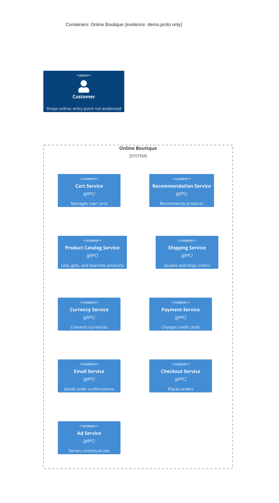

# 1A — Recovered architecture (evidence: `demo.proto` only)

## 1. Agent

- Product: Claude Code (VS Code extension)
- Model: Claude Opus 5.5 (`claude-opus-5-5`)

## 2. Files read

| File | Why |
|---|---|
| `prompts/1-recover-architecture.md` | Task instructions |
| `CLAUDE.md`, `AGENTS.md` | Repository rules |
| `system/online-boutique/protos/demo.proto` | **The only evidence file** |

## 3. Containers table

`demo.proto` defines gRPC service interfaces (`syntax = "proto3"`, `package hipstershop`). Each `service` block is treated as one container. The proto doesn't show implementation languages, deployment units, or data stores.

| Container | Technology / language | Responsibility (from RPCs) | Evidence |
|---|---|---|---|
| Cart Service | gRPC (proto3); language not evidenced | Adds items, returns, and empties a user's cart (`AddItem`, `GetCart`, `EmptyCart`) | `system/online-boutique/protos/demo.proto` (`service CartService`, L23–27) |
| Recommendation Service | gRPC (proto3); language not evidenced | Returns recommended product IDs for a user and a list of products (`ListRecommendations`) | `system/online-boutique/protos/demo.proto` (`service RecommendationService`, L56–58) |
| Product Catalog Service | gRPC (proto3); language not evidenced | Lists, gets, and searches products (`ListProducts`, `GetProduct`, `SearchProducts`) | `system/online-boutique/protos/demo.proto` (`service ProductCatalogService`, L71–75) |
| Shipping Service | gRPC (proto3); language not evidenced | Quotes shipping cost and ships orders, returning a tracking ID (`GetQuote`, `ShipOrder`) | `system/online-boutique/protos/demo.proto` (`service ShippingService`, L107–110) |
| Currency Service | gRPC (proto3); language not evidenced | Lists supported currencies and converts `Money` amounts (`GetSupportedCurrencies`, `Convert`) | `system/online-boutique/protos/demo.proto` (`service CurrencyService`, L140–143) |
| Payment Service | gRPC (proto3); language not evidenced | Charges a credit card and returns a transaction ID (`Charge`) | `system/online-boutique/protos/demo.proto` (`service PaymentService`, L177–179) |
| Email Service | gRPC (proto3); language not evidenced | Sends an order confirmation email (`SendOrderConfirmation`) | `system/online-boutique/protos/demo.proto` (`service EmailService`, L199–201) |
| Checkout Service | gRPC (proto3); language not evidenced | Places an order and returns an `OrderResult` (`PlaceOrder`) | `system/online-boutique/protos/demo.proto` (`service CheckoutService`, L224–226) |
| Ad Service | gRPC (proto3); language not evidenced | Returns ads for page context keywords (`GetAds`) | `system/online-boutique/protos/demo.proto` (`service AdService`, L243–245) |

Data stores: **Not evidenced in the provided files.**

## 4. Dependencies table

A `.proto` file declares interfaces (what each service *offers*). It doesn't say which service *calls* which, so **no runtime dependency is evidenced in the provided files.**

| Caller → callee | Protocol | Evidence |
|---|---|---|
| *(none evidenced)* | — | `demo.proto` contains only `service`/`message` definitions, with no client addresses or call sites |

Candidate dependencies that the message shapes suggest but don't prove are listed under **Gaps**.

## 5. Mermaid diagram

The diagram matches the tables: nine containers and no `Rel`, because no runtime dependency is evidenced. The `Person` is included as the task requires. How the user reaches the system isn't evidenced either (there's no frontend or UI service in the proto).

## 6. Gaps

| Gap | What the proto suggests (if anything) | File(s) that would settle it |
|---|---|---|
| **Who calls whom** (all runtime dependencies) | **[Inferred]** `PlaceOrderRequest` carries `user_id`, `user_currency`, `address`, `email`, `credit_card` (L228–235). `OrderResult` carries `shipping_tracking_id` and `shipping_cost` (L208–214). So Checkout *may* call Cart, Currency, Shipping, Payment, Email, and Product Catalog. | `system/online-boutique/kubernetes-manifests/` (per-service `*_SERVICE_ADDR` env vars) or the Checkout source under `system/online-boutique/src/` *(suggested paths, not opened)* |
| **Frontend / user entry point** | No UI or gateway service is defined. The callers of `GetAds`, `ListRecommendations`, `GetCart` and similar RPCs are unknown. | `kubernetes-manifests/` (frontend deployment and Service) or the frontend source *(suggested, not opened)* |
| **Implementation language of each service** | Not evidenced. `go_package` (L19) only shows that Go stubs are generated, not which services use Go. | Each service's source folder or Dockerfile under `src/` *(suggested, not opened)* |
| **Data stores** (e.g. where carts are stored) | **[Inferred]** `CartService` holds per-user state, so it probably has a backing store. Its type and existence aren't evidenced. | Cart service manifest and source *(suggested, not opened)* |
| **External systems** (real payment gateway, email provider, ad network) | Not evidenced. `Charge` and `SendOrderConfirmation` might be real integrations or mocks. | `paymentservice` and `emailservice` source *(suggested, not opened)* |
| **Deployment / container boundaries** | The proto shows interfaces, not processes. Two services *could* share one process. | `kubernetes-manifests/` *(suggested, not opened)* |
| **Asynchronous messaging / queues** | None in the proto. Every RPC is unary request/response. That doesn't rule out a broker used elsewhere. | `kubernetes-manifests/` and the source *(suggested, not opened)* |
| **Shared message types are compile-time coupling, not runtime dependencies** | `Money`, `CartItem`, `Address`, and `Empty` are shared across services (e.g. `ShipOrderRequest` uses `CartItem`; `ChargeRequest` uses `Money`). This is schema coupling only. | — |
