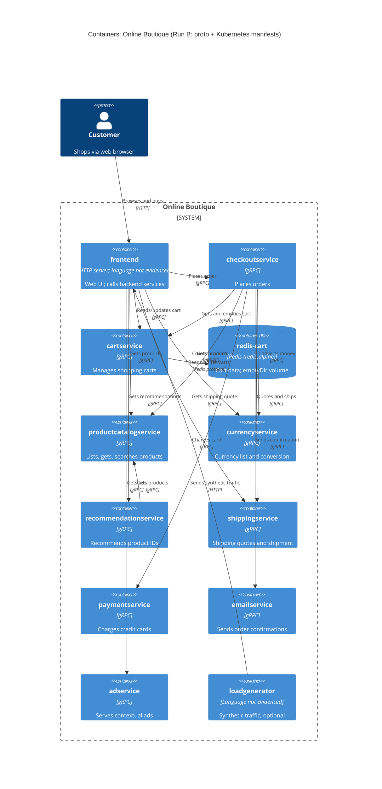

# 1B: Recovered C4 container architecture (Online Boutique)

## 1. Agent

- Product: Claude Code (VS Code extension)
- Model: Claude Opus 5.5 (`claude-opus-5-5`)

## 2. Files read

Evidence files:

- `system/online-boutique/protos/demo.proto`
- `system/online-boutique/kubernetes-manifests/adservice.yaml`
- `system/online-boutique/kubernetes-manifests/cartservice.yaml`
- `system/online-boutique/kubernetes-manifests/checkoutservice.yaml`
- `system/online-boutique/kubernetes-manifests/currencyservice.yaml`
- `system/online-boutique/kubernetes-manifests/emailservice.yaml`
- `system/online-boutique/kubernetes-manifests/frontend.yaml`
- `system/online-boutique/kubernetes-manifests/kustomization.yaml`
- `system/online-boutique/kubernetes-manifests/loadgenerator.yaml`
- `system/online-boutique/kubernetes-manifests/paymentservice.yaml`
- `system/online-boutique/kubernetes-manifests/productcatalogservice.yaml`
- `system/online-boutique/kubernetes-manifests/recommendationservice.yaml`
- `system/online-boutique/kubernetes-manifests/shippingservice.yaml`

Task and rule files: `prompts/1-recover-architecture.md`, `CLAUDE.md`, `AGENTS.md`.

**Outside the allowed scope (disclosed):** before reading `AGENTS.md`, I ran a shell command that printed `exercise/01-recover-architecture.md` (the student worksheet) and listed the folders at the repo root, `prompts/`, `exercise/`, `exercise/outputs/`, `system/online-boutique/` and `kubernetes-manifests/`. I did **not** open `exercise/outputs/1A-architecture.md` or any file under `system/online-boutique/src/`. Nothing in this document is based on the worksheet.

## 3. Containers table

Languages are **not evidenced**. The manifests only give image names (e.g. `image: frontend`), not languages.

| Name | Technology / language | Responsibility | Evidence |
|---|---|---|---|
| `frontend` | Not evidenced in the provided files (HTTP server, port 8080) | Web front end for shoppers. Exposed outside the cluster. Calls the backend services | `kubernetes-manifests/frontend.yaml` (Service `frontend-external` `type: LoadBalancer`, `httpGet /_healthz`, port name `http`) |
| `checkoutservice` | Not evidenced (gRPC server, port 5050) | Places an order (`PlaceOrder`) | `protos/demo.proto` (`service CheckoutService`); `kubernetes-manifests/checkoutservice.yaml` (port `grpc` 5050) |
| `cartservice` | Not evidenced (gRPC server, port 7070) | Adds items, reads and empties a user's cart | `protos/demo.proto` (`service CartService`); `kubernetes-manifests/cartservice.yaml` (port `grpc` 7070) |
| `redis-cart` | Redis (`image: redis:alpine`) | Cart data store. Uses `emptyDir` volume, so data is not durable | `kubernetes-manifests/cartservice.yaml` (Deployment `redis-cart`, `volumes: redis-data emptyDir`) |
| `productcatalogservice` | Not evidenced (gRPC server, port 3550) | Lists, gets and searches products | `protos/demo.proto` (`service ProductCatalogService`); `kubernetes-manifests/productcatalogservice.yaml` |
| `currencyservice` | Not evidenced (gRPC server, port 7000) | Lists supported currencies and converts money | `protos/demo.proto` (`service CurrencyService`); `kubernetes-manifests/currencyservice.yaml` |
| `recommendationservice` | Not evidenced (gRPC server, port 8080) | Returns recommended product IDs | `protos/demo.proto` (`service RecommendationService`); `kubernetes-manifests/recommendationservice.yaml` |
| `shippingservice` | Not evidenced (gRPC server, port 50051) | Gives shipping quotes and ships orders (returns tracking ID) | `protos/demo.proto` (`service ShippingService`); `kubernetes-manifests/shippingservice.yaml` |
| `paymentservice` | Not evidenced (gRPC server, port 50051) | Charges a credit card (returns transaction ID) | `protos/demo.proto` (`service PaymentService`); `kubernetes-manifests/paymentservice.yaml` |
| `emailservice` | Not evidenced (gRPC server, Service port 5000 → container 8080) | Sends order confirmation | `protos/demo.proto` (`service EmailService`); `kubernetes-manifests/emailservice.yaml` |
| `adservice` | Not evidenced (gRPC server, port 9555) | Returns ads for context keywords | `protos/demo.proto` (`service AdService`); `kubernetes-manifests/adservice.yaml` |
| `loadgenerator` | Not evidenced (init container uses `busybox`) | Generates synthetic user traffic against the frontend (`USERS=10`, `RATE=1`). Not in the default kustomization | `kubernetes-manifests/loadgenerator.yaml`; `kubernetes-manifests/kustomization.yaml` (line commented out) |

## 4. Dependencies table

How the protocol was determined: a caller's `*_ADDR` env var gives `host:port`. When the callee's Service port is named `grpc` and the callee has a gRPC readiness probe and a `demo.proto` service, the dependency is labelled gRPC.

| Caller → callee | Protocol | Evidence |
|---|---|---|
| Customer → `frontend` | HTTP | `frontend.yaml` (Service `frontend-external`, `type: LoadBalancer`, port `http` 80 → 8080) |
| `loadgenerator` → `frontend` | HTTP | `loadgenerator.yaml` (`FRONTEND_ADDR=frontend:80`; init container `wget http://${FRONTEND_ADDR}`) |
| `frontend` → `productcatalogservice` | gRPC | `frontend.yaml` (`PRODUCT_CATALOG_SERVICE_ADDR=productcatalogservice:3550`) |
| `frontend` → `currencyservice` | gRPC | `frontend.yaml` (`CURRENCY_SERVICE_ADDR=currencyservice:7000`) |
| `frontend` → `cartservice` | gRPC | `frontend.yaml` (`CART_SERVICE_ADDR=cartservice:7070`) |
| `frontend` → `recommendationservice` | gRPC | `frontend.yaml` (`RECOMMENDATION_SERVICE_ADDR=recommendationservice:8080`) |
| `frontend` → `shippingservice` | gRPC | `frontend.yaml` (`SHIPPING_SERVICE_ADDR=shippingservice:50051`) |
| `frontend` → `checkoutservice` | gRPC | `frontend.yaml` (`CHECKOUT_SERVICE_ADDR=checkoutservice:5050`) |
| `frontend` → `adservice` | gRPC | `frontend.yaml` (`AD_SERVICE_ADDR=adservice:9555`) |
| `checkoutservice` → `productcatalogservice` | gRPC | `checkoutservice.yaml` (`PRODUCT_CATALOG_SERVICE_ADDR=productcatalogservice:3550`) |
| `checkoutservice` → `shippingservice` | gRPC | `checkoutservice.yaml` (`SHIPPING_SERVICE_ADDR=shippingservice:50051`) |
| `checkoutservice` → `paymentservice` | gRPC | `checkoutservice.yaml` (`PAYMENT_SERVICE_ADDR=paymentservice:50051`) |
| `checkoutservice` → `emailservice` | gRPC | `checkoutservice.yaml` (`EMAIL_SERVICE_ADDR=emailservice:5000`) |
| `checkoutservice` → `currencyservice` | gRPC | `checkoutservice.yaml` (`CURRENCY_SERVICE_ADDR=currencyservice:7000`) |
| `checkoutservice` → `cartservice` | gRPC | `checkoutservice.yaml` (`CART_SERVICE_ADDR=cartservice:7070`) |
| `recommendationservice` → `productcatalogservice` | gRPC | `recommendationservice.yaml` (`PRODUCT_CATALOG_SERVICE_ADDR=productcatalogservice:3550`) |
| `cartservice` → `redis-cart` | Redis protocol (TCP 6379) | `cartservice.yaml` (`REDIS_ADDR=redis-cart:6379`; Service `redis-cart` port `tcp-redis`) |

## 5. Mermaid diagram

The relationship labels (e.g. "Gets shipping quote") are **[Inferred]** by matching the callee's RPCs in `demo.proto`. The manifests prove only *that* the caller is configured with the callee's address, not *which* RPCs it calls.

## 6. Gaps

| Gap | Why it is open | File that would settle it |
|---|---|---|
| Implementation language of every service | Manifests give only image names; `demo.proto` is language-neutral | Each `src/<service>/Dockerfile` or main source file (e.g. `src/checkoutservice/main.go`) |
| `shoppingassistantservice` (frontend has `SHOPPING_ASSISTANT_SERVICE_ADDR=shoppingassistantservice:80`) | No manifest in `kubernetes-manifests/` deploys it and it has no `demo.proto` service, so it is left out of the diagram. `ENABLE_ASSISTANT` is commented out | `kustomize/components/shopping-assistant/` (referenced but commented out in `kustomization.yaml`) and the frontend source |
| Whether the frontend actually uses each configured address, and which RPCs it calls | An env var proves configuration, not a runtime call | `src/frontend/` source (e.g. `main.go`, `handlers.go`) |
| Whether services call each other without an `*_ADDR` env var (e.g. hard-coded defaults) | Only env vars were visible | Each service's source |
| External systems (real payment gateway, SMTP/email provider, currency-rate source) | No external hosts or credentials in the manifests, so no `System_Ext` is drawn. Probably mocks **[Inferred]**, but this is not evidenced | `src/paymentservice/`, `src/emailservice/`, `src/currencyservice/` source |
| Data stores for product catalog, ads, currency rates | No DB container or address env var. They may be in-process or file-based **[Inferred]**, but this is not evidenced | `src/productcatalogservice/` (e.g. a products JSON file), `src/adservice/`, `src/currencyservice/` |
| Optional alternate stores (Memorystore, AlloyDB, Spanner) and Packaging service (`PACKAGING_SERVICE_URL`, commented out) | Referenced only as commented-out kustomize components or env vars | `kustomize/components/memorystore/`, `alloydb/`, `spanner/` and the frontend source |
| Whether `frontend` → `shippingservice` is a real call | Configured in `frontend.yaml`; the purpose (quote on the cart page) is **[Inferred]** | `src/frontend/` source |
| Whether `loadgenerator` is part of a normal deployment | Its manifest exists but the line is commented out in `kustomization.yaml` ("skaffold.yaml will be used") | `skaffold.yaml` |
| Ingress, service mesh, network policies | Only an Istio annotation (`sidecar.istio.io/rewriteAppHTTPProbers`) is present; `network-policies` component is commented out | `istio-manifests/`, `kustomize/components/network-policies/` |
