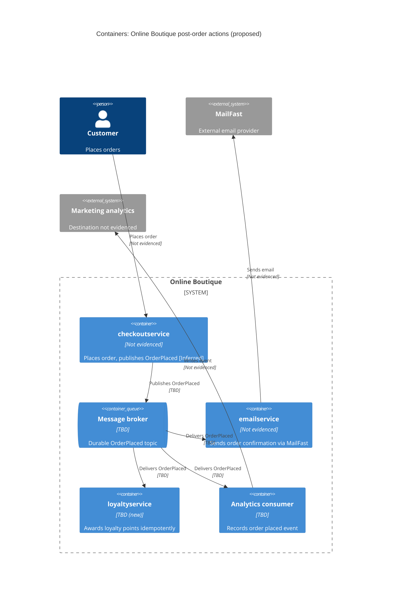

> Agent: Claude Code (VS Code extension) · Model: Claude Opus 5.5 (`claude-opus-5-5`) · Run a (zero-shot, context: none)

# ADR-0002: Publish an "OrderPlaced" event to a message broker for post-order actions

- **Status:** Proposed
- **Date:** 2026-10-26
- **Deciders:** Not evidenced in the provided files (ดู Open questions)

## Context and problem

หลังจากลูกค้าสั่งซื้อสำเร็จ Online Boutique ต้องทำงานต่อไปนี้ (จาก requirement):

1. ส่งอีเมลยืนยันคำสั่งซื้อผ่าน **MailFast** ซึ่งเป็น email provider ภายนอกรายใหม่ แทนที่ logic แบบ mock ใน `emailservice`
2. ให้แต้มสะสม (loyalty points) ผ่าน `loyaltyservice` ซึ่งยังไม่มีและต้องสร้างใหม่
3. บันทึก analytics event "order placed" ให้ทีม marketing

นอกจากนี้ marketing คาดว่าปีหน้าจะมี post-order action เพิ่มอีก (SMS, fraud scoring, การอัปเดต recommendations)

ปัญหาที่ต้องตัดสินใจ: **service ที่สั่งซื้อควรเชื่อมกับงานหลังการสั่งซื้อเหล่านี้อย่างไร** ทั้งงานที่มีอยู่ตอนนี้ 3 งาน และงานที่จะเพิ่มในอนาคต

สิ่งที่ข้อความ requirement ไม่ได้ระบุ (จึงไม่ได้นำมาใช้เป็นข้อเท็จจริง):

- service ไหนเป็นผู้ "place order" — ADR นี้สมมติว่าเป็น `checkoutservice` **[Inferred]** (Not evidenced in the provided files)
- ปริมาณคำสั่งซื้อ ช่วงพีก latency budget ของการ checkout, rate limit/SLA ของ MailFast, กฎการให้แต้ม — Not evidenced in the provided files
- ปัจจุบัน service สื่อสารกันด้วยโปรโตคอลอะไร และมี message broker อยู่แล้วหรือไม่ — Not evidenced in the provided files

## Decision drivers

เรียงตามความสำคัญ (ลำดับนี้เป็น **[Inferred]** ต้องให้ deciders ยืนยัน):

1. **Modifiability / extensibility:** ต้องเพิ่ม post-order action ใหม่ (SMS, fraud scoring, recommendations) ได้โดยไม่ต้องแก้ service ที่สั่งซื้อทุกครั้ง (มาจาก requirement โดยตรง)
2. **Availability ของการสั่งซื้อ:** ถ้า MailFast (ระบบภายนอก), `loyaltyservice` หรือระบบ analytics ล่มหรือช้า การสั่งซื้อของลูกค้าไม่ควรล้มเหลวตามไปด้วย **[Inferred]**
3. **Reliability / correctness ของผลข้างเคียง:** อีเมลและแต้มสะสมต้องไม่หายเมื่อเกิด failure และแต้มไม่ควรถูกให้ซ้ำสำหรับคำสั่งซื้อเดียวกัน **[Inferred]**
4. **Performance (checkout latency):** งานหลังการสั่งซื้อไม่ควรเพิ่มเวลาตอบสนองของการ checkout (ไม่มีตัวเลข budget — ดู Open questions)
5. **Operability และ cost:** จำนวน component ใหม่ที่ต้องดูแล และความถนัดของทีม (ไม่ระบุ — ดู Open questions)

## Considered options

1. **Synchronous orchestration:** service ที่สั่งซื้อเรียก MailFast adapter (`emailservice`), `loyaltyservice` และ analytics ตรง ๆ ทีละตัว (เช่น ผ่าน gRPC/HTTP) ก่อนตอบกลับลูกค้า
2. **In-process async:** service ที่สั่งซื้อตอบกลับลูกค้าก่อน แล้วรันการเรียกทั้งสามใน background (thread/goroutine/worker pool) ภายใน process ของตัวเอง
3. **Event-driven ผ่าน message broker (publish/subscribe):** service ที่สั่งซื้อ publish event `OrderPlaced` เพียงครั้งเดียวไปยัง message broker แล้ว `emailservice` (เรียก MailFast), `loyaltyservice` และ analytics consumer แต่ละตัว subscribe แยกกันพร้อม retry ของตัวเอง

### Pros and cons of the options

| Option | Pros | Cons |
|---|---|---|
| 1. Synchronous orchestration | เข้าใจง่าย debug ง่าย; รู้ผลทันทีว่างานแต่ละอย่างสำเร็จหรือไม่; ไม่มี infrastructure ใหม่ | checkout latency = ผลรวมของทุกการเรียก; MailFast/`loyaltyservice`/analytics ล่ม ทำให้ checkout ล้มหรือช้า (availability ต่ำลง); เพิ่ม action ใหม่ต้องแก้และ deploy service ที่สั่งซื้อทุกครั้ง (modifiability ต่ำ); coupling สูงกับ provider ภายนอก |
| 2. In-process async | ลูกค้าไม่ต้องรอ (latency ดี); ไม่มี infrastructure ใหม่; ทำได้เร็ว | งานหายถ้า process crash/restart ระหว่างทำ (ไม่มี durable buffer); retry/backoff และ rate limiting ต้องเขียนเองในทุก action; ยังต้องแก้ service ที่สั่งซื้อเมื่อเพิ่ม action ใหม่; service ที่สั่งซื้อต้องรับภาระ resource ของงานรอง |
| 3. Event-driven ผ่าน broker | เพิ่ม action ใหม่ = เพิ่ม subscriber ใหม่ โดยไม่แตะ publisher (modifiability สูง); checkout ไม่ขึ้นกับ availability ของ consumer หรือ MailFast; broker เก็บ event แบบ durable ทำให้ retry ได้หลัง consumer ล่ม; แต่ละ consumer scale และควบคุมอัตราการเรียก (เช่นตาม rate limit ของ MailFast) ได้อิสระ | ต้องเพิ่มและดูแล message broker (operability, cost); ได้ eventual consistency — อีเมล/แต้มอาจมาช้ากว่าการสั่งซื้อ; ส่วนใหญ่ broker ให้ at-least-once delivery จึงต้องทำ consumer ให้ idempotent; ต้องจัดการ dual-write (บันทึกคำสั่งซื้อ + publish event) ไม่ให้ event หาย; trace/debug ข้าม service ยากขึ้น |

## Decision

เลือก **Option 3: Event-driven ผ่าน message broker (publish/subscribe)**

- service ที่สั่งซื้อ (สมมติว่าเป็น `checkoutservice` **[Inferred]**) publish event `OrderPlaced` หนึ่งครั้งต่อคำสั่งซื้อ หลังการสั่งซื้อสำเร็จ โดย event มี `order_id` ที่ไม่ซ้ำ
- `emailservice` เปลี่ยนจาก mock เป็น consumer ที่เรียก MailFast เพื่อส่งอีเมลยืนยัน (MailFast ถูกห่อไว้หลัง adapter ใน `emailservice` เพื่อให้เปลี่ยน provider ได้ภายหลัง)
- `loyaltyservice` (ใหม่) เป็น consumer ที่ให้แต้ม โดยใช้ `order_id` เป็น idempotency key เพื่อไม่ให้แต้มถูกให้ซ้ำเมื่อ event ถูกส่งซ้ำ
- analytics consumer บันทึก event "order placed" ให้ marketing
- action ในอนาคต (SMS, fraud scoring, recommendations) เพิ่มเป็น subscriber ใหม่
- ยังไม่เลือกผลิตภัณฑ์ broker (เช่น RabbitMQ หรือ Kafka) เพราะไม่มีข้อมูลเรื่องปริมาณงาน ความต้องการ replay และความถนัดของทีม — ดู Open questions

เหตุผล: Option 3 เป็นทางเดียวที่ตอบ driver อันดับ 1 (เพิ่ม action ใหม่โดยไม่แก้ publisher) และ driver อันดับ 2 (แยก availability ของ checkout ออกจาก MailFast และ service อื่น) ได้พร้อมกัน ส่วน Option 2 ตอบเรื่อง latency ได้แต่เสี่ยงงานหายและยังต้องแก้ publisher ทุกครั้งที่เพิ่ม action

## Consequences

- **Positive:** เพิ่ม post-order action ใหม่ได้ด้วยการเพิ่ม subscriber โดยไม่แก้หรือ redeploy `checkoutservice` (quality attribute: modifiability)
- **Positive:** การสั่งซื้อยังสำเร็จได้แม้ MailFast, `loyaltyservice` หรือ analytics ล่มชั่วคราว เพราะ event ค้างอยู่ใน broker รอ retry (quality attribute: availability, fault isolation)
- **Positive:** checkout ไม่ต้องรอการเรียก MailFast หรือ `loyaltyservice` (quality attribute: performance — latency ของ checkout)
- **Positive:** consumer แต่ละตัว scale และ throttle ได้อิสระ เช่นจำกัดอัตราการเรียก MailFast (quality attribute: scalability)
- **Positive:** MailFast อยู่หลัง adapter ใน `emailservice` จึงเปลี่ยน provider ได้โดยไม่กระทบ service อื่น (quality attribute: modifiability)
- **Negative:** ต้องติดตั้ง ดูแล และ monitor message broker เพิ่ม (quality attribute: operability, cost)
- **Negative:** อีเมลและแต้มเป็น eventual consistency — ลูกค้าอาจเห็นแต้มหรือได้อีเมลช้ากว่าการสั่งซื้อ (quality attribute: consistency, usability)
- **Negative:** การติดตามว่าคำสั่งซื้อหนึ่งผ่านงานใดบ้างแล้วยากขึ้น ต้องมี distributed tracing/correlation ID (quality attribute: observability)
- **Risks and mitigations:**
  - *Event ซ้ำ (at-least-once delivery)* → อาจส่งอีเมลหรือให้แต้มซ้ำ: ทำ consumer ให้ idempotent โดยใช้ `order_id` เป็น key (บังคับสำหรับ `loyaltyservice`; สำหรับอีเมลขึ้นกับว่า MailFast รองรับ idempotency key หรือไม่ — ดู Open questions)
  - *Event หายระหว่างบันทึกคำสั่งซื้อกับ publish (dual-write)* → ใช้ transactional outbox หรือ publish พร้อม retry ใน publisher; รูปแบบที่เหมาะขึ้นกับว่าคำสั่งซื้อถูกเก็บที่ไหน (Not evidenced in the provided files)
  - *Event ที่ประมวลผลไม่สำเร็จซ้ำ ๆ (poison message)* → ใช้ dead-letter queue พร้อม alert
  - *MailFast จำกัดอัตราหรือล่ม* → retry แบบ exponential backoff และ throttle ใน consumer ของ `emailservice`
  - *Broker เป็น single point of failure ของ post-order actions* → ใช้การ deploy แบบ replicated (ไม่กระทบการสั่งซื้อถ้าใช้ outbox)
  - *Schema ของ `OrderPlaced` เปลี่ยนแล้ว consumer พัง* → กำหนดเวอร์ชันของ schema และเปลี่ยนแบบ backward-compatible
  - *Event มีข้อมูลส่วนบุคคล (อีเมล ที่อยู่)* → ส่งเฉพาะ field ที่แต่ละ consumer จำเป็น หรือให้ consumer ดึงเพิ่มเอง (นโยบาย privacy Not evidenced in the provided files)

## Validation

- **Failure test:** ปิด `emailservice`, `loyaltyservice` และ analytics consumer ระหว่าง load test แล้วยืนยันว่าการสั่งซื้อยังสำเร็จ 100% และเมื่อเปิดกลับ consumer ประมวลผล event ที่ค้างครบ
- **Duplicate test:** ส่ง event `OrderPlaced` เดียวกันซ้ำหลายครั้ง แล้วยืนยันว่าแต้มถูกให้เพียงครั้งเดียวต่อ `order_id`
- **Latency test:** เทียบ checkout latency (เช่น p95) ก่อนและหลังเปลี่ยน — เกณฑ์ผ่านต้องกำหนดเมื่อรู้ latency budget (ดู Open questions)
- **Metrics ใน production:** consumer lag ของแต่ละ subscriber, เวลาจากสั่งซื้อจนอีเมลถูกส่ง, จำนวนข้อความใน dead-letter queue, error/throttle rate จาก MailFast — เกณฑ์ alert ต้องกำหนดภายหลัง
- **Extensibility check:** เมื่อเพิ่ม action แรกของปีหน้า (เช่น SMS) ยืนยันว่าไม่ต้องแก้โค้ดของ `checkoutservice`
- **Review date:** ทบทวน ADR นี้ก่อนเริ่มงาน post-order action ใหม่ของปีหน้า (วันที่แน่นอน Not evidenced in the provided files)

## Open questions

1. ใครคือ deciders ของ ADR นี้?
2. service ไหนเป็นผู้ place order จริง (`checkoutservice` หรือไม่) และคำสั่งซื้อถูกเก็บถาวรที่ไหน (มีผลต่อการทำ transactional outbox)?
3. ปริมาณคำสั่งซื้อเฉลี่ยและช่วงพีกเป็นเท่าไร และ latency budget ของ checkout เท่าไร?
4. MailFast มี rate limit, quota, SLA, ค่าใช้จ่ายต่อข้อความ, API/โปรโตคอล และรองรับ idempotency key หรือไม่?
5. อีเมลยืนยันต้องถึงลูกค้าภายในเวลาเท่าไรหลังสั่งซื้อ (ยอมรับ eventual consistency ได้แค่ไหน)?
6. กฎการให้แต้มคืออะไร ต้องการ "exactly once" อย่างเคร่งครัดหรือไม่ และต้องปรับแต้มเมื่อยกเลิก/คืนสินค้าหรือไม่?
7. analytics event ต้องส่งไปที่ระบบใดของ marketing และยอมให้ event หายหรือซ้ำได้หรือไม่?
8. ตอนนี้ service สื่อสารกันด้วยโปรโตคอลอะไร และมี message broker อยู่ในระบบแล้วหรือไม่?
9. ทีมมีประสบการณ์กับ broker ตัวใด (เช่น RabbitMQ หรือ Kafka) และมีงบหรือข้อจำกัดเรื่อง infrastructure หรือไม่?
10. post-order action ในอนาคต (เช่น fraud scoring) ต้องทำ **ก่อน** ยืนยันคำสั่งซื้อหรือไม่? ถ้าใช่ จะไม่เข้ากับรูปแบบ asynchronous ของ ADR นี้
11. มีข้อกำหนดด้าน privacy/PDPA สำหรับข้อมูลลูกค้าที่ส่งไป MailFast และใส่ใน event หรือไม่?
