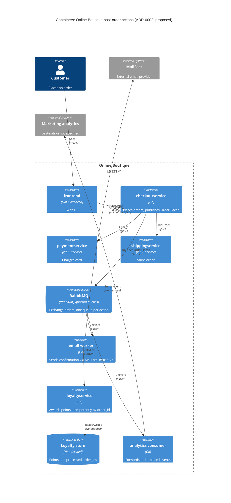

> Agent: Claude Code (VS Code extension) · Model: Claude Opus 5.5 (`claude-opus-5-5`) · Run: b (with context)

# ADR-0002: Publish an `OrderPlaced` event to RabbitMQ for post-order actions

- **Status:** Proposed
- **Date:** 2026-10-26
- **Deciders:** ทีมพัฒนา 4 คน (`docs/scenario.md`, แถว Team); ผู้อนุมัติขั้นสุดท้ายยังไม่ระบุ (ดู Open questions)

## Context and problem

Requirement **R-12** (`docs/scenario.md`) กำหนดว่าหลังจากสั่งซื้อสำเร็จ ระบบต้องทำ 3 อย่าง: (1) ส่งอีเมลยืนยันผ่าน **MailFast** แทน logic จำลองใน `emailservice` (2) ให้ **loyalty points** ผ่าน `loyaltyservice` ตัวใหม่ (3) บันทึก analytics event **"order placed"** ให้ทีม marketing และปีหน้าจะมี post-order action เพิ่มอีก (SMS, fraud scoring, recommendations update)

**สภาพปัจจุบัน (จากโค้ด):**

| ข้อเท็จจริง | หลักฐาน |
|---|---|
| `PlaceOrder` เรียก `paymentservice` → `shippingservice` → `cartservice` → `emailservice` แบบ synchronous gRPC ตามลำดับ | `system/online-boutique/src/checkoutservice/main.go:252-277` (`chargeCard`, `shipOrder`, `emptyUserCart`, `sendOrderConfirmation`) |
| ถ้าส่งอีเมลไม่สำเร็จ แค่ log warning แล้ว order ยังสำเร็จ | `main.go:273-277` (`log.Warnf("failed to send order confirmation ...")`) |
| `orderID` สร้างเป็น UUID ตั้งแต่ต้น `PlaceOrder` จึงใช้เป็น idempotency key ได้ | `main.go:233` (`uuid.NewUUID()`) |
| ยอดรวม `total` คำนวณใน `PlaceOrder` แต่ **ไม่ได้** อยู่ใน `OrderResult` | `main.go:243-250`, `main.go:265-271` |
| `checkoutservice` มีแต่ gRPC client ไปยัง service อื่น ไม่มี database หรือ message broker ของตัวเอง | `main.go:66-86` (struct `checkoutService`), `main.go:111-123` |
| ทุก dependency ผูกไว้ตอน start ด้วย env var และ `mustConnGRPC` | `main.go:115` (`EMAIL_SERVICE_ADDR`), `main.go:202-220` |

**ตัวเลขที่ต้องคำนึง** (`docs/scenario.md`, Quality goals and constraints):

- p95 ของ `PlaceOrder` ต้อง **≤ 500 ms** (ปัจจุบันประมาณ 300 ms) → เหลือ budget ประมาณ 200 ms
- peak **200 orders/s** ช่วง 11.11
- MailFast: p95 **1.5 s**, p99 **8 s**, fail ประมาณ **0.5 %**, rate limit **50 emails/s**
- Loyalty points: ต้องให้ภายใน **1 นาที** และ **exactly once**
- Order ต้อง **ไม่ fail** เพราะ email, loyalty หรือ analytics ล่ม

**ปัญหา:** ถ้าเพิ่ม MailFast เข้าไปใน call chain แบบ synchronous ตามรูปแบบเดิม เฉพาะ MailFast อย่างเดียว (p95 1.5 s) ก็เกิน budget 500 ms แล้ว และช่วง peak ระบบรับ order 200/s แต่ MailFast รับได้ 50/s ดังนั้นจะทำ post-order actions ทั้ง 3 อย่าง (และที่จะเพิ่มในอนาคต) ด้วยกลไกอะไร

## Decision drivers

1. **Availability:** order ต้องไม่ fail เพราะ email, loyalty หรือ analytics ล่ม (scenario: Availability)
2. **Performance:** p95 `PlaceOrder` ≤ 500 ms ที่ 200 orders/s (scenario: Checkout latency, Peak load)
3. **Reliability / correctness:** loyalty points ต้องได้ภายใน 1 นาที และ exactly once; อีเมลต้องไม่หายเมื่อ MailFast fail 0.5 % หรือถูก rate limit
4. **Modifiability:** เพิ่ม post-order action ใหม่ (SMS, fraud scoring, recommendations) โดยแก้ `checkoutservice` ให้น้อยที่สุด
5. **Team fit และ cost:** ทีม 4 คน เก่ง Go/gRPC มี 2 คนเคยใช้ RabbitMQ; ทุกอย่างรันบน Kubernetes; บริษัทชอบ open-source self-hosted มากกว่า managed service ที่ผูกกับ cloud

## Considered options

1. **Synchronous gRPC ต่อท้าย `PlaceOrder`** (ขยายรูปแบบเดิม): เรียก MailFast, `loyaltyservice`, analytics ตามลำดับก่อนตอบ client
2. **Async ภายใน process (goroutine fire-and-forget)**: `PlaceOrder` ตอบ client ก่อน แล้วสั่ง goroutine ไปเรียกทั้ง 3 ปลายทาง
3. **Publish event `OrderPlaced` ไปยัง RabbitMQ (self-hosted)**: `checkoutservice` publish ครั้งเดียวไปที่ exchange แล้วแต่ละ consumer มี queue ของตัวเอง (email worker, `loyaltyservice`, analytics)
4. **Publish event `OrderPlaced` ไปยัง Apache Kafka (self-hosted)**: เหมือนข้อ 3 แต่ใช้ topic ใน Kafka และ consumer group แยกตาม action

### Pros and cons of the options

| Option | Pros | Cons |
|---|---|---|
| 1. Sync gRPC | เปลี่ยนน้อยที่สุด ทีมคุ้นเคย; รู้ผลทันที; ไม่มี component ใหม่ | MailFast p95 1.5 s ทำให้ p95 `PlaceOrder` เกิน 500 ms ไปไกล; ช่วง peak 200 orders/s เกิน rate limit 50/s ทำให้อีเมล 3 ใน 4 ฉบับถูกปฏิเสธ; ไม่มี retry ที่ทนทาน (อีเมลที่ fail ก็แค่ log แบบเดียวกับ `main.go:273-277`); ทุก action ใหม่ต้องแก้ `PlaceOrder` และเพิ่ม latency |
| 2. Goroutine ใน process | latency ของ `PlaceOrder` ไม่เพิ่ม; ไม่มี infrastructure ใหม่; ภาษา Go ทำได้ง่าย | งานอยู่แค่ใน memory: ถ้า pod restart/crash งานที่ค้างหายไป (loyalty ไม่ได้ points, อีเมลไม่ถูกส่ง); ทำ rate limit 50/s รวมทุก replica ได้ยาก; ไม่มี backlog ช่วง peak; exactly once ทำไม่ได้ถ้าไม่มี durable state; ทุก action ใหม่ยังต้องแก้ `checkoutservice` |
| 3. RabbitMQ | ตัด latency ของ MailFast ออกจาก `PlaceOrder`; queue ที่ durable เก็บ backlog ช่วง peak ได้ และ email worker ดึงงานด้วยอัตราไม่เกิน 50/s; queue ของแต่ละ consumer แยกกัน ทำให้ loyalty ไม่ต้องรอคิวอีเมล; มี manual ack, retry, dead-letter queue; เพิ่ม action ใหม่ด้วยการผูก queue ใหม่เข้า exchange โดยไม่ต้องแก้ `checkoutservice`; open-source, self-hosted บน Kubernetes; ทีม 2 คนเคยใช้ | มี component stateful ใหม่ให้ดูแล (cluster, quorum queue, monitoring); delivery เป็น at-least-once ดังนั้น `loyaltyservice` ต้อง dedupe เอง; `checkoutservice` ไม่มี database (`main.go:66-86`) จึงทำ transactional outbox ทันทีไม่ได้ (ดู Risks); ถ้าส่งอีเมลผิด event ต้อง replay เอง เพราะ message ถูกลบเมื่อ ack แล้ว |
| 4. Kafka | ได้ข้อดีเรื่อง decoupling เหมือนข้อ 3; เก็บ event เป็น log ที่ replay ได้ (เหมาะกับ analytics และ consumer ใหม่ที่ต้องอ่านย้อนหลัง); throughput สูง; open-source, self-hosted | ทีมไม่มีประสบการณ์ Kafka (scenario ระบุแค่ RabbitMQ); operate ยากกว่าสำหรับทีม 4 คน; การ retry/dead-letter ต่อ message และการจำกัดอัตรา 50/s ต้องเขียนเองที่ consumer; consumer ที่ล้มเหลวกับ message เดียวอาจทำให้ทั้ง partition ค้าง; ความสามารถ replay ยังไม่ใช่ requirement ที่ระบุไว้ |

## Decision

เลือก **Option 3: publish event `OrderPlaced` ไปยัง RabbitMQ** ดังนี้

- หลังจาก `shipOrder` สำเร็จ (`main.go:258-261`) `checkoutservice` จะ publish message `OrderPlaced` **หนึ่งครั้ง** ไปยัง exchange `orders` (ใช้แทนการเรียก `sendOrderConfirmation` ที่ `main.go:273`) payload ประกอบด้วย `order_id` (จาก `main.go:233`), `user_id`, `email`, `items`, `total` (จาก `main.go:243-250`, ซึ่งปัจจุบันไม่อยู่ใน `OrderResult`), `shipping_tracking_id` และเวลาที่สั่ง
- publish ด้วย **persistent message + publisher confirms** และ timeout สั้น; ถ้า publish ไม่สำเร็จ **order ยังต้องสำเร็จ** (driver 1) และให้ retry จาก buffer ภายใน process พร้อมยิง alert
- แต่ละ action มี **durable quorum queue ของตัวเอง** ที่ bind กับ exchange:
  - `email.order-confirmation` → **email worker** (Go) เรียก MailFast และจำกัดอัตรารวม **≤ 50 emails/s** ทุก replica, retry แบบ backoff เมื่อ MailFast fail แล้วส่ง dead-letter queue เมื่อ retry ครบ
  - `loyalty.award-points` → `loyaltyservice` (Go, ใหม่) ให้ points แบบ **idempotent** โดยใช้ `order_id` เป็น unique key ในที่เก็บข้อมูลของตัวเอง แล้วค่อย ack (at-least-once delivery + dedupe = ผลลัพธ์ exactly once)
  - `analytics.order-placed` → analytics consumer ส่ง event ไปยังปลายทางของทีม marketing
- รัน RabbitMQ บน Kubernetes ที่มีอยู่แล้วแบบ self-hosted (cluster 3 node สำหรับ quorum queue)

**เหตุผล:** เป็นตัวเลือกเดียวที่ผ่าน driver 1–4 พร้อมกัน: ตัด latency และความล้มเหลวของ MailFast/loyalty/analytics ออกจาก `PlaceOrder` (availability, performance), เก็บงานไว้อย่าง durable เพื่อดูดซับ peak 200/s ให้เหลือ 50/s ได้ (reliability), และเพิ่ม action ใหม่ได้ด้วยการเพิ่ม queue (modifiability) เมื่อเทียบกับ Kafka แล้ว RabbitMQ ตรงกับทักษะของทีมมากกว่า และมี per-message ack, dead-letter, prefetch ให้ใช้ทันที ซึ่งตรงกับงานแบบ "หนึ่ง message = หนึ่ง task" ของ R-12 (driver 5)

## Consequences

- **Positive:** `PlaceOrder` ไม่ต้องรอ MailFast (p95 1.5 s, p99 8 s) อีกต่อไป เหลือแค่ต้นทุนการ publish หนึ่งครั้ง จึงน่าจะอยู่ใน budget 500 ms ได้ (quality attribute: performance)
- **Positive:** email, loyalty หรือ analytics ล่มไม่ทำให้ order fail; message จะรออยู่ใน queue จนกว่า consumer จะกลับมา (quality attribute: availability)
- **Positive:** ช่วง peak queue ทำหน้าที่ buffer: order เข้ามา 200/s แต่ email worker ส่งออกไม่เกิน 50/s จึงไม่ชน rate limit ของ MailFast; อีเมลที่ fail 0.5 % ได้ retry แทนที่จะหายไปเหมือนตอนนี้ (`main.go:273-277`) (quality attribute: reliability)
- **Positive:** loyalty มี queue ของตัวเอง จึงไม่ต้องรอ backlog ของอีเมล และสามารถทำตามเป้า 1 นาทีได้; dedupe ด้วย `order_id` ป้องกัน points ซ้ำ (quality attribute: correctness)
- **Positive:** SMS, recommendations update และ consumer อื่นในอนาคต เพิ่มได้ด้วยการ bind queue ใหม่ โดยไม่ต้องแก้หรือ deploy `checkoutservice` ใหม่ (quality attribute: modifiability)
- **Negative:** เพิ่ม component stateful (RabbitMQ cluster) ที่ต้อง operate, monitor และ upgrade; ทีมมีแค่ 2 ใน 4 คนที่เคยใช้ (quality attribute: operability, cost)
- **Negative:** อีเมลยืนยันจะช้าลงช่วง peak: backlog โตขึ้น 150 ฉบับ/วินาที (200 − 50) ระหว่าง peak และใช้เวลา drain ประมาณ 3 วินาทีต่อทุก 1 วินาทีของ peak หลังจาก peak จบ (quality attribute: timeliness ของอีเมล)
- **Negative:** consistency กลายเป็นแบบ eventual: client ได้คำตอบว่าสำเร็จก่อนที่ email/loyalty/analytics จะทำเสร็จ และไม่มี response ใดบอกผลของ action เหล่านั้น (quality attribute: consistency, observability)
- **Negative:** debug ยากขึ้น เพราะ flow ข้าม broker; ต้องส่ง trace context ใน message header ต่อ (ตอนนี้ trace ส่งผ่าน gRPC เท่านั้น `main.go:134-141`) (quality attribute: observability)
- **Risks and mitigations:**
  - **Dual-write / event หาย:** payment และ shipping สำเร็จแล้ว แต่ publish ไม่สำเร็จ (broker ล่ม) และ pod crash ก่อน retry → ลูกค้าไม่ได้อีเมลและ points ซึ่งขัดกับข้อกำหนด loyalty. *Mitigation:* publisher confirms + retry buffer + alert ในระยะแรก; ถ้ายอมรับความเสี่ยงนี้ไม่ได้ ให้เพิ่ม transactional outbox ซึ่งต้องมี datastore ใหม่ให้ `checkoutservice` (ปัจจุบันไม่มี `main.go:66-86`)
  - **RabbitMQ เป็น single point of failure ของ post-order actions:** *Mitigation:* quorum queue บน 3 node, PodDisruptionBudget, alert ที่ queue depth และ unacked messages
  - **Duplicate delivery** (retry ของ publisher หรือ redelivery ของ broker): *Mitigation:* ทุก consumer ต้อง idempotent ด้วย `order_id`; สำหรับอีเมลอาจยอมให้ซ้ำได้บ้าง (ต้องยืนยัน, ดู Open questions)
  - **Rate limit รวมของ MailFast:** ถ้าหลาย replica ของ email worker ต่างคนต่างจำกัด 50/s ก็จะเกินรวมกัน. *Mitigation:* จำกัดต่อ replica เป็น 50/N หรือรัน consumer ตัวเดียว และใช้ retry ไม่ให้กิน budget เกิน
  - **Poison message:** *Mitigation:* dead-letter queue ต่อ queue พร้อม alert และเครื่องมือ re-publish
  - **Fraud scoring อาจไม่ใช่ post-order action:** ถ้าต้องบล็อก order ก่อน charge จะต้องเป็นการเรียกแบบ synchronous ก่อน `chargeCard` (`main.go:252`) ไม่ใช่ consumer ของ event นี้

## Validation

- **Load test** ด้วย `loadgenerator` ที่ **200 orders/s**: p95 `PlaceOrder` ต้อง **≤ 500 ms** เมื่อ publish ไปยัง RabbitMQ แล้ว
- **Failure test:** ปิด email worker, `loyaltyservice`, analytics consumer และ MailFast (mock) ทีละตัวระหว่าง load test → order ต้องสำเร็จ 100 % และ message ต้องค้างใน queue แล้วถูกประมวลผลเมื่อ consumer กลับมา
- **Exactly-once test:** ส่ง `OrderPlaced` ที่ `order_id` ซ้ำ และ kill `loyaltyservice` ก่อน ack → ยอด points ต้องเพิ่มเพียงครั้งเดียวต่อ order
- **Loyalty latency metric:** เวลาตั้งแต่ publish จนถึงบันทึก points; p99 ต้อง **< 60 s** ที่ peak 200 orders/s
- **MailFast metric:** อัตราส่งจริงต้องไม่เกิน **50 emails/s**; ติดตามจำนวน 429/error, ขนาด DLQ และอายุ message เก่าสุดใน `email.order-confirmation`
- **Review date:** ทบทวน ADR นี้ก่อนเพิ่ม action แรกของปีหน้า (SMS/fraud/recommendations) หรือหลัง 11.11 ครั้งแรกที่ใช้ระบบนี้

## Open questions

1. **ระยะเวลา peak 11.11** ยาวเท่าไร? ใช้คำนวณขนาด backlog ของอีเมล (150 × จำนวนวินาทีของ peak) และขนาด disk ของ RabbitMQ
2. **อีเมลยืนยันช้าได้สูงสุดเท่าไร** หลังจากสั่งซื้อ? ช่วง peak อาจช้าหลายนาทีถึงหลายชั่วโมงเพราะ rate limit 50/s
3. **อีเมลยืนยันซ้ำ** ยอมรับได้หรือไม่ หรือต้อง exactly once เหมือน loyalty?
4. **ยอมรับความเสี่ยงที่ event หาย** เมื่อ broker ล่มพร้อมกับ pod crash ได้หรือไม่? ถ้าไม่ได้ ต้องเพิ่ม transactional outbox และ datastore ใหม่ให้ `checkoutservice`
5. **ปลายทางของ analytics** ของทีม marketing คืออะไร (data warehouse, tool ภายนอก, ...)? ต้องการ replay event ย้อนหลังหรือไม่ (ถ้าต้องการ Kafka จะได้เปรียบขึ้น)
6. **กฎการคำนวณ loyalty points** (ขึ้นกับ `total`, สกุลเงิน, items?) และ `loyaltyservice` จะใช้ datastore อะไร
7. **MailFast rate limit 50/s** นับต่อ API key หรือต่อบัญชี? มี burst หรือ batch API หรือไม่? และ MailFast ให้ API แบบไหน (protocol, idempotency key)?
8. **`emailservice` เดิม** จะถูกเขียนใหม่ให้เป็น email worker หรือ retire ไปเลย (`EMAIL_SERVICE_ADDR` ที่ `main.go:115` เป็น required env var)? ภาษาและโค้ดของ `emailservice` ไม่อยู่ในไฟล์ที่ได้รับ (Not evidenced in the provided files)
9. **Fraud scoring** ต้องตัดสินก่อนรับ order (synchronous) หรือหลังรับ order (async)?
10. **RabbitMQ ต้องการ resource เท่าไร** และใครเป็นผู้ดูแลในเวลา on-call? ทีม ops ไม่ได้ระบุไว้ใน scenario
11. **ผู้อนุมัติ ADR นี้** คือใคร?
